# OnlineShop

A fast, secure, multilingual online shop for small businesses: an **ASP.NET Core 10 Web API on PostgreSQL** and a
**Next.js 16 PWA** storefront with its admin panel, in one repository. One Docker stack per shop, on Linux or Windows;
the same images serve every shop.

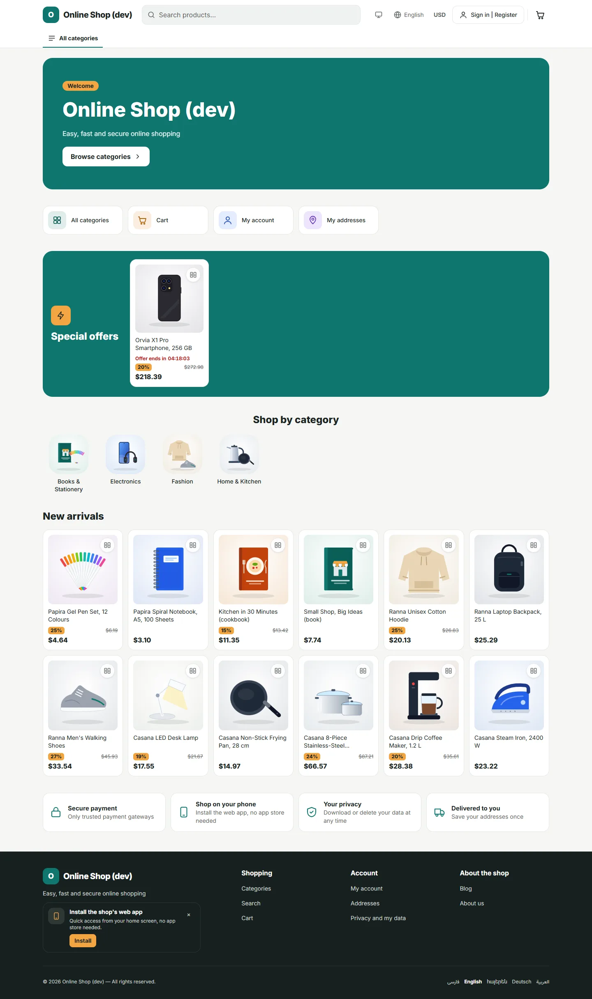

| Product page | Category listing with filters |
|---|---|
| 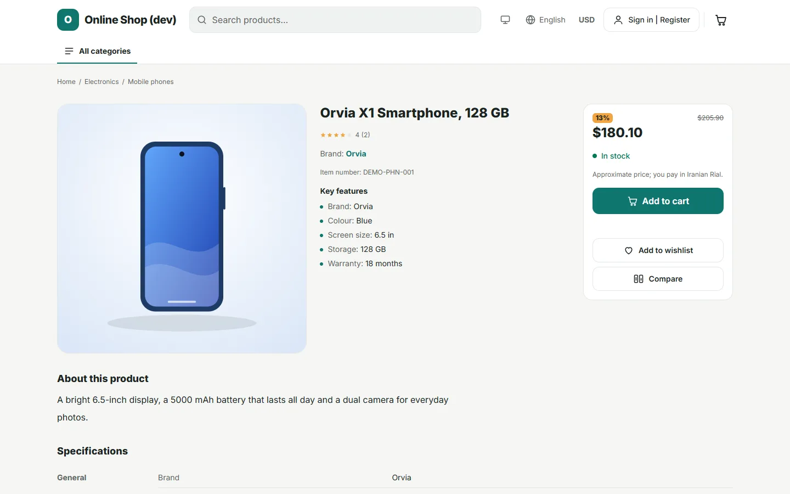 | 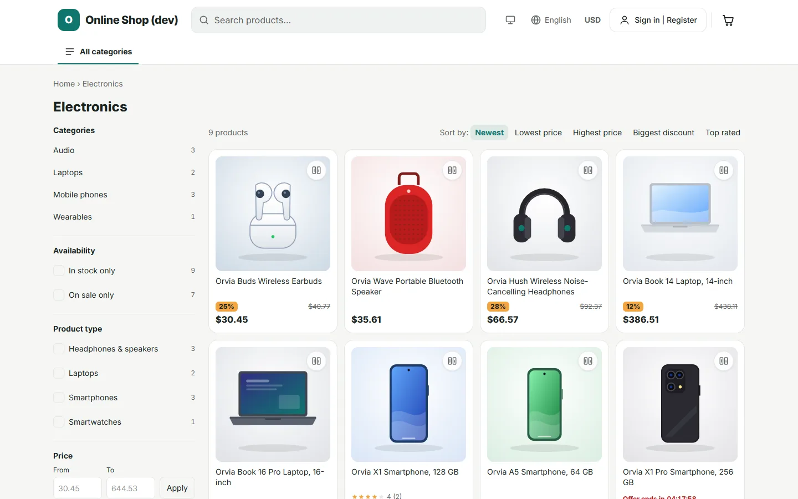 |
| **Search** | **Product comparison** |
| 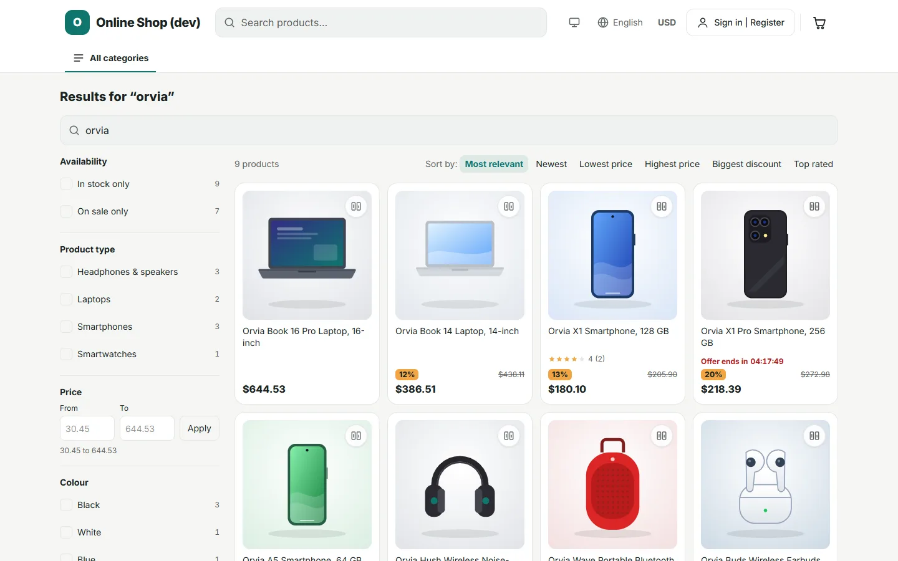 | 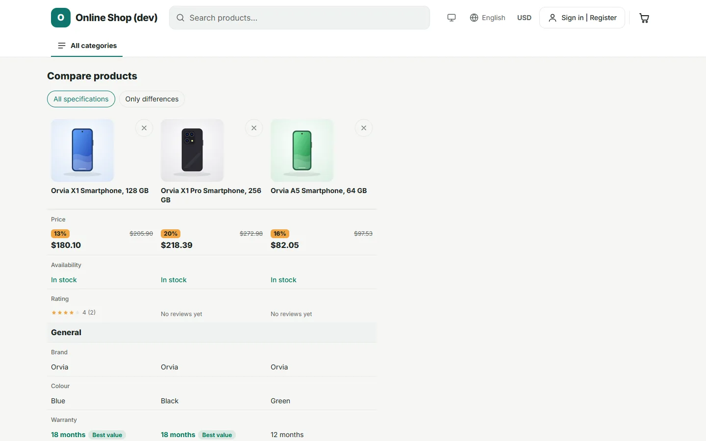 |
| **Cart** | **Checkout** |
| 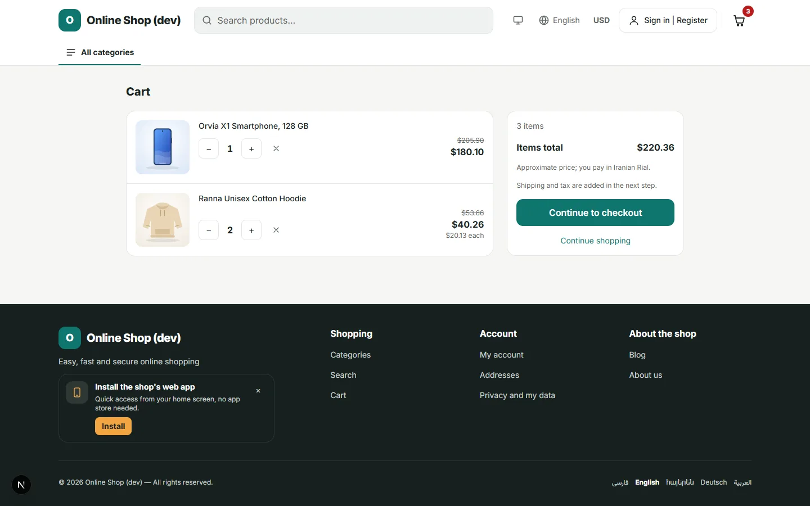 | 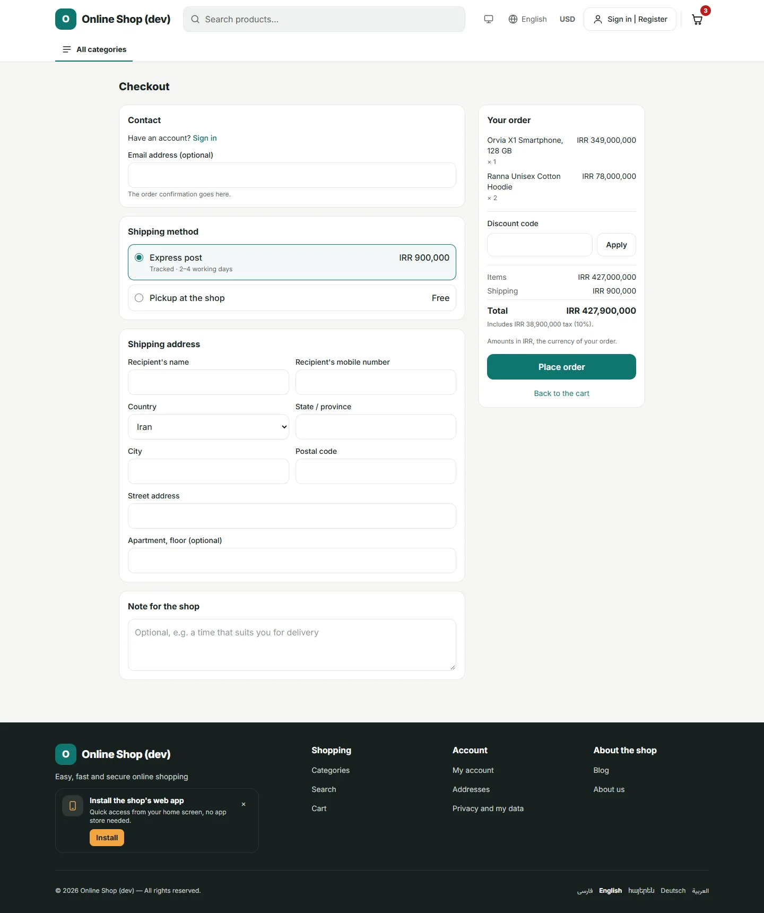 |
| **Admin panel** | **Admin: products** |
| 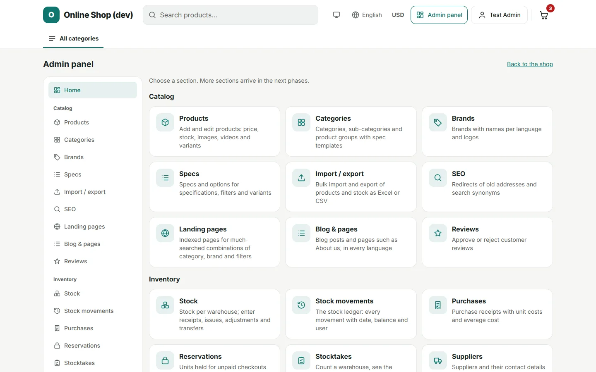 | 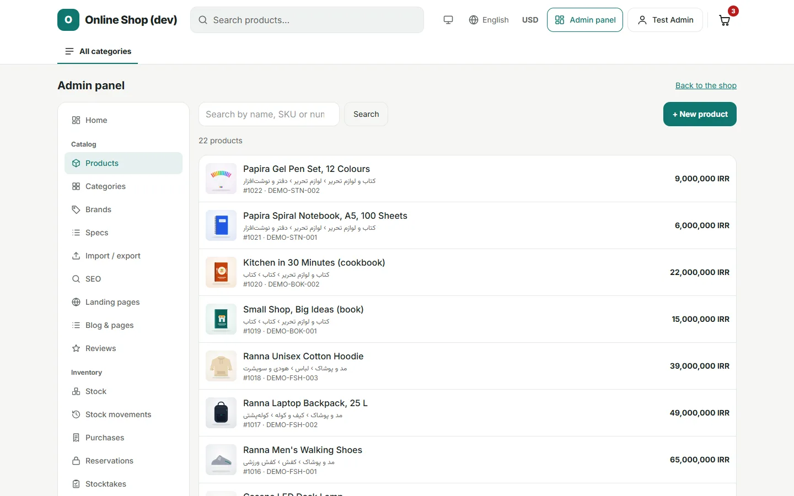 |
| **Admin: shipping and tax** | **Persian (RTL) on a phone, light and dark** |
| 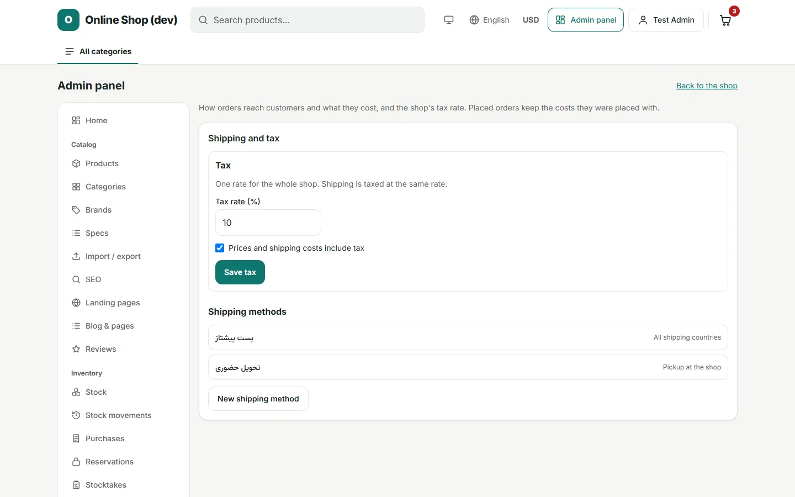 | 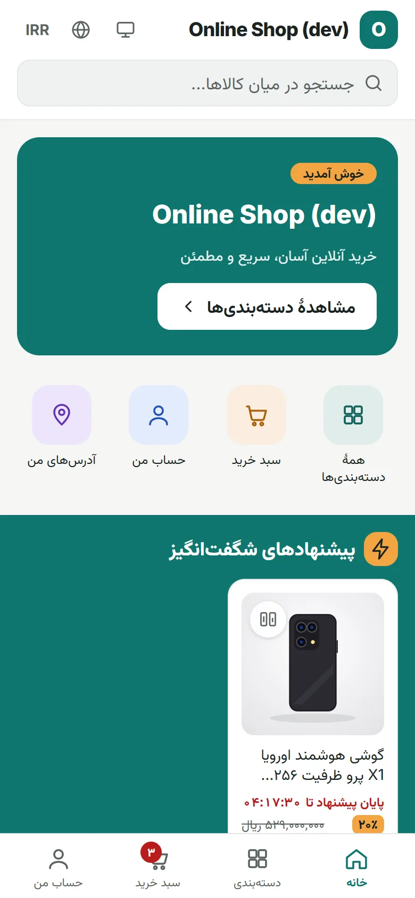 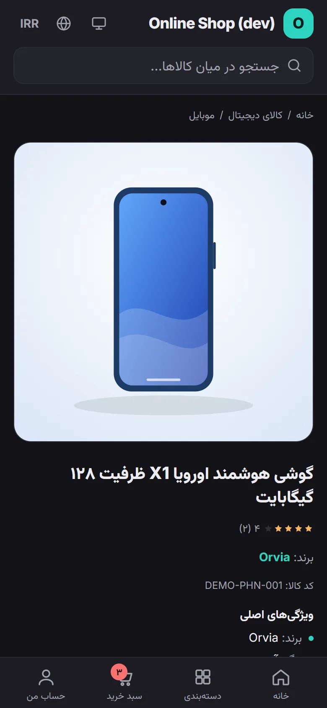 |

*Screenshots of the local demo shop (demo catalog, English unless noted).*

## Features

**Storefront**
- Five languages (Persian, English, Armenian, German, Arabic) with right-to-left layouts, light and dark themes,
  installable as a PWA, mobile-first.
- Server-rendered, SEO-complete pages: canonical and hreflang addresses, JSON-LD matching the visible price and stock,
  sitemaps, redirects, landing pages for much-searched combinations, a blog and content pages.
- Full-text search in PostgreSQL (synonyms, typo suggestions, keyboard-layout fixes), optionally OpenSearch or
  Elasticsearch; category and brand listings with faceted filters.
- Product variants (colour, size, …), specifications, comparison, reviews with moderation, wishlist, special offers
  with countdowns, display currencies with the shop's own rates.
- Cart for guests and customers (merged after sign-in), checkout with saved or new addresses, shipping methods,
  tax and discount codes. Prices and totals are always computed on the server.

**Accounts and security**
- Sign-in by email or mobile number (SMS codes, optional), external logins, two-factor authentication, address
  book, download or erase all personal data.
- HttpOnly session cookies through the storefront (no tokens in the browser), CSRF origin checks, rate limits,
  permission-based staff roles (Admin, Manager, Warehouse, Accountant).

**Admin panel**
- Products with images, videos and variants; categories, brands, specification templates; bulk import and export
  (Excel/CSV); SEO redirects and synonyms.
- Inventory: stock ledger per warehouse, purchases with average cost, stocktakes, reservations for unpaid orders.
- Shipping methods and tax, discount codes, currencies and rates, branding (logo, colours, layout), staff and
  invitations with an audit log.

Next: order management, PDF invoices and returns, then payment gateways (Stripe, PayPal, ZarinPal and others) and
accounting. The full plan and every recorded decision are in [docs/ROADMAP.md](docs/ROADMAP.md) (Persian).

## Architecture

```
src/       .NET Clean Architecture: Domain, Application, Infrastructure, Infrastructure.Migrations.PostgreSql, Api
apps/web/  Next.js storefront and admin panel (PWA)
tests/     .NET unit (xUnit, SQLite) and integration tests (real PostgreSQL)
deploy/    Dockerfiles, docker-compose, nginx example
docs/      roadmap, SEO/marketing design, screenshots
```

- **Backend:** minimal APIs under `/api/v1`, business rules in Application services, EF Core code-first with one
  migrations project per database (PostgreSQL now; SQL Server and MySQL planned).
- **Frontend:** Next.js App Router with server rendering and cache components; it talks to the API through its own
  proxy, so the session cookie never reaches JavaScript.
- **No runtime dependency on outside services:** fonts, icons and scripts are self-hosted (needed for shops hosted
  in Iran and for GDPR).

More: [docs/SEO-MARKETING.md](docs/SEO-MARKETING.md) · deploying a shop: [deploy/README.md](deploy/README.md) ·
working on the code (also for AI assistants): [CLAUDE.md](CLAUDE.md)

## Development quick start

Requirements: .NET SDK 10, Node.js 26 LTS, PostgreSQL 18.

```bash
dotnet tool restore
dotnet user-secrets set "ConnectionStrings:Default" "Host=localhost;Database=onlineshop_dev;Username=...;Password=..." --project src/OnlineShop.Api
dotnet run --project src/OnlineShop.Api          # http://localhost:5087, migrates the dev database
cd apps/web && npm install && npm run dev        # http://localhost:3000
```

**One F5 for both:** in Visual Studio open `OnlineShop.sln` and pick the **"API + web"** launch profile of
`OnlineShop.Api` (the first profile). It starts the API, runs `npm run dev` in `apps/web` (unless the storefront is
already running), opens the browser on the storefront and stops Next.js when debugging stops. The same from a
terminal: `dotnet run --project src/OnlineShop.Api --launch-profile "API + web"`. Run `npm install` in `apps/web`
once first. The `http` profile starts the API alone. If the connection string is missing, startup stops with the
exact user-secrets file it looked for.

**Demo data (local only):** in Development the API fills a demo catalog (about 22 products in all five languages) and
creates two accounts with confirmed emails: `customer@shop.localhost` (customer) and `admin@shop.localhost` (Admin).
The shared test password is in `src/OnlineShop.Api/appsettings.Development.json` (`DemoUsers`). The accounts are never
created in any other environment or with a non-local public URL. Emails in Development are not sent: they are saved
as `.eml` files in `src/OnlineShop.Api/App_Data/mail/` (SMS codes in `App_Data/sms/`).

**Tests:** `dotnet test` (integration tests need `IntegrationTests:AdminConnection`, see CLAUDE.md) and `npm test`
in `apps/web`.
